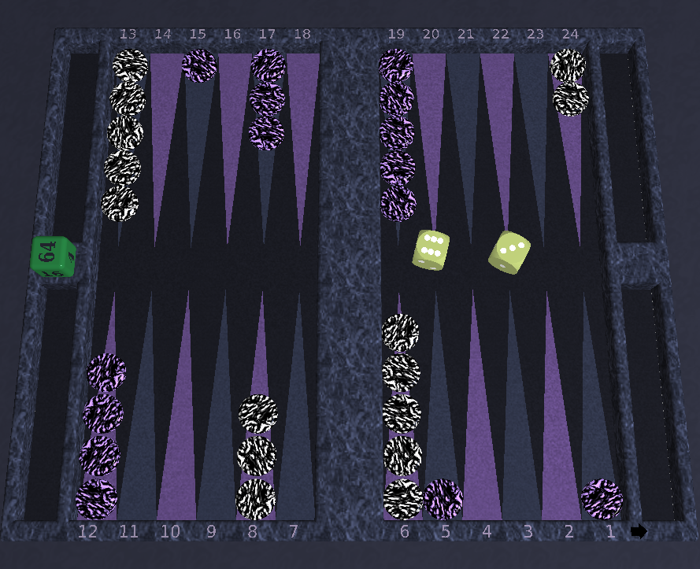

# 🧛 Dracula 3D for GNU Backgammon

A dark, modern, and vibrant **3D board theme** for **GNU Backgammon (gnubg)** inspired by the famous [Dracula Theme](https://draculatheme.com). Give your 3D backgammon matches a sleek, eye-catching, and dark-mode friendly look!

---

## ✨ Features

* 🎲 **Full 3D Experience:** Specifically crafted for gnubg's OpenGL 3D board view.
* 🧛 **Dracula Colors:** Features the classic dark background, crisp purples, and vibrant accents.
* 👁️ **Eye-Care Friendly:** Designed for long analysis sessions without straining your eyes.
* 🚀 **1-Click Import:** Ready-to-use XML configuration file for instant setup.

---

## 🚀 Installation & Setup

Applying the 3D theme is incredibly easy thanks to the XML export:

1. **Download** the `dracula-3d.xml` file from this repository.
2. **Open** GNU Backgammon.
3. Go to the top menu and select **Settings** ➡️ **Appearance** ➡️ **Designs** (make sure **3D** mode is active).
4. Click on **Import** and select the downloaded `dracula-3d.xml` file.
5. Click **Save Settings** so the theme applies automatically on every startup! 💾

---

## 🤝 Contributing

Contributions, issues, and feature requests are welcome! Feel free to check the [issues page](../../issues).

## 📝 License

This project is [GNU GPLv3](LICENSE) licensed.

---

Made with 💜 for the Backgammon Community.

